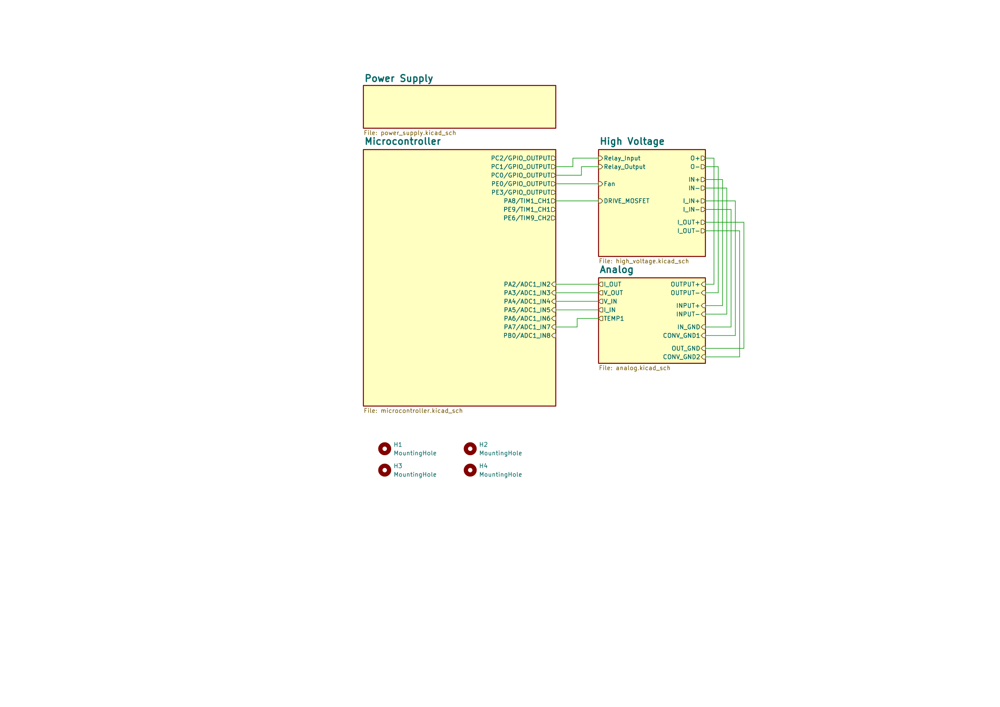
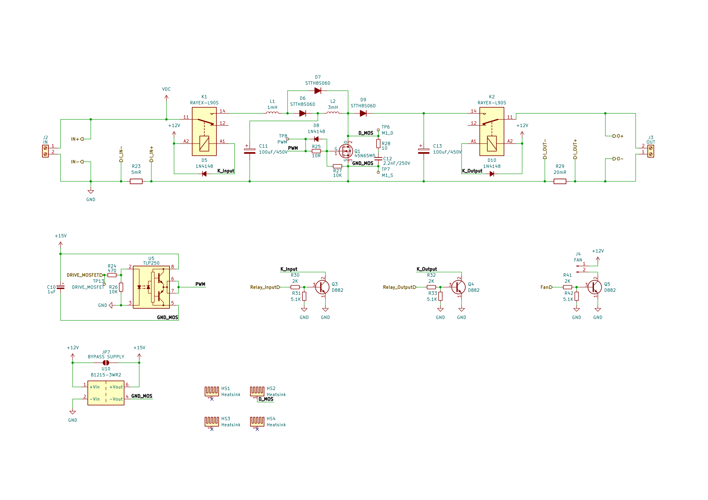
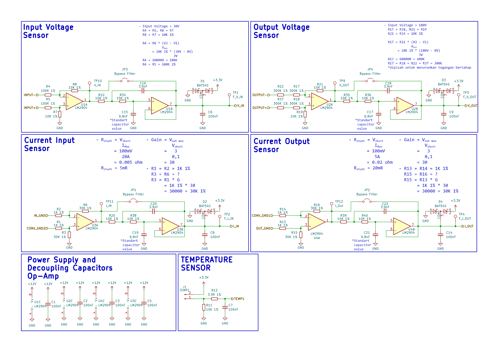
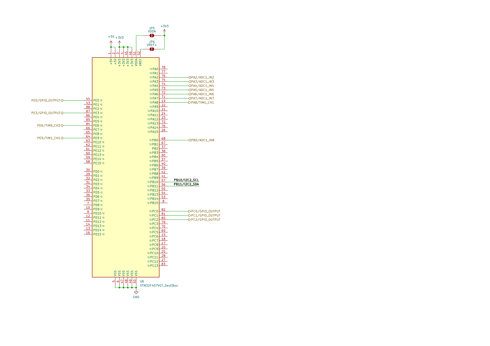
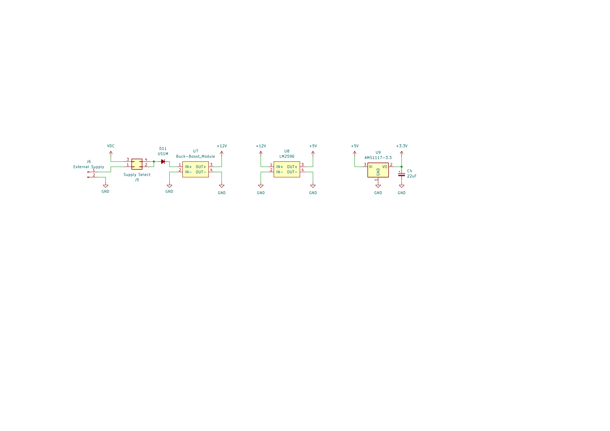

<div align="center">

# High-Gain Quadratic Boost Converter dengan H∞ Controller

**Desain perangkat keras (KiCad) dan firmware STM32F407VGT untuk QBC 18 V → 150 V
dengan pengendali mixed-sensitivity H∞ voltage-mode**


Repositori pendukung skripsi *Implementasi Hardware High-Gain Quadratic Boost Converter
dengan H∞ Controller* — Program Studi Teknik Elektro, Fakultas Teknik,
Universitas Negeri Semarang (2026).

</div>

---

## Daftar isi

- [Ringkasan](#ringkasan)
- [Spesifikasi sistem](#spesifikasi-sistem)
- [Struktur repositori](#struktur-repositori)
- [Perangkat keras (KiCad)](#perangkat-keras-kicad)
- [Firmware](#firmware)
- [Alur validasi MIL–SIL–PIL–hardware](#alur-validasi-milsilpilhardware)
- [Keselamatan](#keselamatan)
- [Sitasi](#sitasi)
- [Penulis](#penulis)

## Ringkasan

Quadratic Boost Converter (QBC) *single-switch* memberi penguatan
V<sub>o</sub>/V<sub>in</sub> = 1/(1 − D)², sehingga 18 V dapat dinaikkan ke 150 V
pada duty cycle sekitar 0,65 tanpa duty ekstrem. Fungsi alih duty-ke-keluaran QBC
memiliki zero di setengah bidang kanan dan resonansi teredam lemah, sehingga
repositori ini memakai **H∞ controller mixed-sensitivity voltage-mode** yang
hanya membutuhkan satu sensor tegangan keluaran.

Isi repositori:

1. **Desain board QBC lengkap di KiCad**: skematik hierarkis 5 lembar, layout PCB
   2 layer, pustaka simbol/footprint lokal, dan model 3D.
2. **Firmware kontroler** untuk STM32F407VGT (DevEBox) dalam dua versi, Arduino/STM32duino
   dan Keil/STM32 HAL. Kode kontrolernya (`controller_step.c`) sama persis dengan yang
   divalidasi pada MIL-2, SIL, dan PIL.
3. **Skrip MATLAB H∞** ([`matlab/`](matlab/)): sintesis mixed-sensitivity, diskretisasi,
   ekspor kode C, uji unit SIL, dan PIL lockstep.
4. **Pin map** yang mengikat firmware dan PCB ([`PINMAP.md`](PINMAP.md)).

## Spesifikasi sistem

| Parameter | Nilai |
|---|---|
| Tegangan masukan V<sub>in</sub> | 18 V |
| Tegangan keluaran V<sub>o</sub> | 150 V (D ≈ 0,654) |
| Beban nominal | R = 135 Ω (≈ 167 W) |
| Frekuensi switching f<sub>s</sub> | 10 kHz |
| Induktor L<sub>1</sub> / L<sub>2</sub> | 1 mH / 3 mH (operasi CCM) |
| Kapasitor C<sub>1</sub> / C<sub>2</sub> | 100 µF / 100 µF |
| Semikonduktor | MOSFET 650 V, dioda STTH8S06D (600 V, 8 A) |
| Gate driver | TLP250 (isolasi optik) + catu terisolasi B1215-3WR2 |
| Mikrokontroler | STM32F407VGT (DevEBox), PWM TIM1_CH1 @ PA8, ADC1_IN3 @ PA3 |
| Kontroler | H∞ diskret state-space orde 6, T<sub>s</sub> = 100 µs |
| Waktu eksekusi (PIL) | ≈ 3,6 µs per langkah (≈ 3,6 % periode kontrol) |
| Proteksi firmware | duty 0…0,65, OVP latch 165 V, input fault PD8, PWM mati saat boot |
| PCB | 2 layer, 150 × 175 mm, 125 footprint |

## Struktur repositori

```
.
├── hardware/
│   ├── kicad/                     proyek KiCad (buka Quadratic_Boost_Converter_v0.1.kicad_pro)
│   │   ├── *.kicad_sch            skematik hierarkis: root, high_voltage, analog,
│   │   │                          microcontroller, power_supply
│   │   ├── *.kicad_pcb            layout PCB 2 layer
│   │   └── lib/                   pustaka simbol & footprint lokal proyek
│   ├── schematic/                 ekspor PDF skematik (lengkap dan per lembar)
│   └── 3d/                        model 3D board (.glb) + penampil 3D di browser (index.html)
├── hil_stm32/                     firmware versi utama: Arduino IDE + STM32duino (USB CDC)
├── keil_hal/                      firmware versi cadangan: Keil uVision / STM32 HAL (USART3)
├── matlab/                        skrip H∞: sintesis → diskretisasi (MIL-2) → SIL (MEX) → PIL
├── docs/img/                      gambar untuk dokumentasi
└── PINMAP.md                      pin map DevEBox ↔ PCB QBC
```

## Perangkat keras (KiCad)

Proyek dibuat dengan **KiCad 10**. Buka
`hardware/kicad/Quadratic_Boost_Converter_v0.1.kicad_pro`. Semua footprint sudah
tertanam di file PCB, dan pustaka lokal yang dipakai disertakan di `hardware/kicad/lib/`
dengan path relatif (`${KIPRJMOD}`). Proyek bisa langsung dibuka di komputer lain
tanpa mengatur path pustaka.

| Lembar | Isi |
|---|---|
| Root | Hierarki utama, hubungan antarlembar, lubang mounting |
| `high_voltage` | Rangkaian daya QBC (L₁, L₂, C₁, C₂, D₁–D₃, MOSFET), relai masukan/keluaran, shunt arus |
| `analog` | Sensor tegangan masukan/keluaran, sensor arus masukan/keluaran, sensor suhu, filter anti-aliasing |
| `microcontroller` | Header DevEBox STM32F407VGT, alokasi pin PWM/ADC/GPIO |
| `power_supply` | Regulator board, catu op-amp, penggerak relai & kipas |

<details>
<summary><b>Pratinjau skematik</b> (klik untuk membuka)</summary>

**Hierarki utama**


**Rangkaian daya tegangan tinggi**


**Sensing analog**


**Mikrokontroler**


**Catu daya**


</details>

PDF skematik lengkap: [`hardware/schematic/QBC_schematic_full.pdf`](hardware/schematic/QBC_schematic_full.pdf).

**Model 3D.** [`hardware/3d/index.html`](hardware/3d/index.html) adalah penampil
3D mandiri (three.js) yang memuat model board. Unduh lalu buka di browser, atau buka
langsung lewat GitHub Pages jika sudah diaktifkan untuk repositori ini.
File `.glb` juga bisa dibuka di penampil glTF apa pun.

## Firmware

Ada dua versi firmware dengan pin, parameter, proteksi, dan perintah serial yang sama.
Pilih salah satu, karena flash yang satu akan menimpa yang lain.

| Versi | Toolchain | Serial | Status |
|---|---|---|---|
| [`hil_stm32/`](hil_stm32/) | Arduino IDE + STM32duino | USB CDC (micro-USB DevEBox) | **Utama, sudah diuji di board (PWM terverifikasi di osiloskop)** |
| [`keil_hal/`](keil_hal/) | Keil uVision / arm-none-eabi-gcc + STM32 HAL | USART3 (PB10/PB11) | Cadangan, terkompilasi, belum diuji di board |

Langkah kontrol setiap 100 µs:

```
ADC PA3 → Vo  ─┐
               ├─► controller_step(vref, vo) ─► duty (jepit 0…0,65) ─► TIM1 CCR (PA8, 10 kHz)
vref (ramp) ───┘
```

Perintah serial (115200 baud, diakhiri newline):

| Perintah | Fungsi |
|---|---|
| `e` | Mulai kontrol (vref naik dengan ramp dari Vo terukur) |
| `v<angka>` | Set vref target dalam volt, contoh `v50` (maks 150 V) |
| `d` | Stop dan reset / hapus FAULT |
| `p` | Tampilkan status |
| `k<angka>` | Kalibrasi pengali Vo, contoh `k0.98` |
| `m<angka>` / `a` | Uji meja: timpa Vo manual / kembali ke ADC |

Telemetri: `T,ms,state,vref,vo,duty,cycles,overrun` (state 0 = OFF, 1 = RUN, 2 = FAULT).
Petunjuk kompilasi dan flash ada di README masing-masing folder.

> `controller_step.c/.h` dan `controller_coeffs.h` dihasilkan dari sintesis H∞ di MATLAB
> ([`matlab/`](matlab/)) dan **tidak boleh diubah manual**. File yang sama dipakai di MIL-2, SIL, PIL, dan board.

## Alur validasi MIL–SIL–PIL–hardware

| Tahap | Konfigurasi | Kriteria / hasil |
|---|---|---|
| **MIL** | Model plant + kontroler kontinu/diskret di Simulink | Respons referensi, disturbance rejection, robustness |
| **SIL** | `controller_step()` dalam blok C Function Simulink (diuji unit lebih dulu via MEX terhadap `dlsim`) | max\|Δ\| ≈ 10⁻⁶ terhadap MATLAB; metrik dibandingkan dengan baseline MIL-2 |
| **PIL** | `controller_step.c` berjalan di STM32F407VGT, lockstep via USB CDC | Selisih duty terhadap MIL-2 < 10⁻⁷; eksekusi ≈ 3,6 µs |
| **Hardware** | Firmware di board QBC (repositori ini) | Bertahap: PWM → gate driver → power stage tegangan rendah → nominal |

Pengendali pembanding voltage-mode (PI respons frekuensi dan MPSO-PI) dirancang
dengan model plant, skenario uji, dan batas margin kestabilan yang sama.

## Keselamatan

Board ini menghasilkan **tegangan DC hingga 150 V**, yang berbahaya.

- Uji PWM dan gate driver lebih dulu tanpa power stage, lalu naikkan tegangan masukan bertahap.
- Pastikan duty 0 berarti MOSFET OFF dan OVP firmware aktif sebelum menyambung beban.
- Kapasitor keluaran dapat menyimpan muatan setelah sumber dimatikan; buang muatannya sebelum menyentuh board.

## Sitasi

```bibtex
@thesis{sinaga2026qbc,
  author  = {Yohanes Leonaldo Sinaga},
  title   = {Implementasi Hardware High-Gain Quadratic Boost Converter dengan H$\infty$ Controller},
  school  = {Universitas Negeri Semarang},
  type    = {Skripsi},
  year    = {2026},
  url     = {https://github.com/ikigai-arch/QBCHinfSTM32F407VGT}
}
```

## Penulis

- **Yohanes Leonaldo Sinaga** (NIM 2305100046): perancangan kontroler, firmware, validasi
- Pembimbing: **Rizky Ajie Aprilianto, S.Pd., M.Eng.**
- Tim capstone: Muhammad Arya Ardiansyah, Zieda Alfu Ni'am

Program Studi Teknik Elektro, Fakultas Teknik, Universitas Negeri Semarang.
